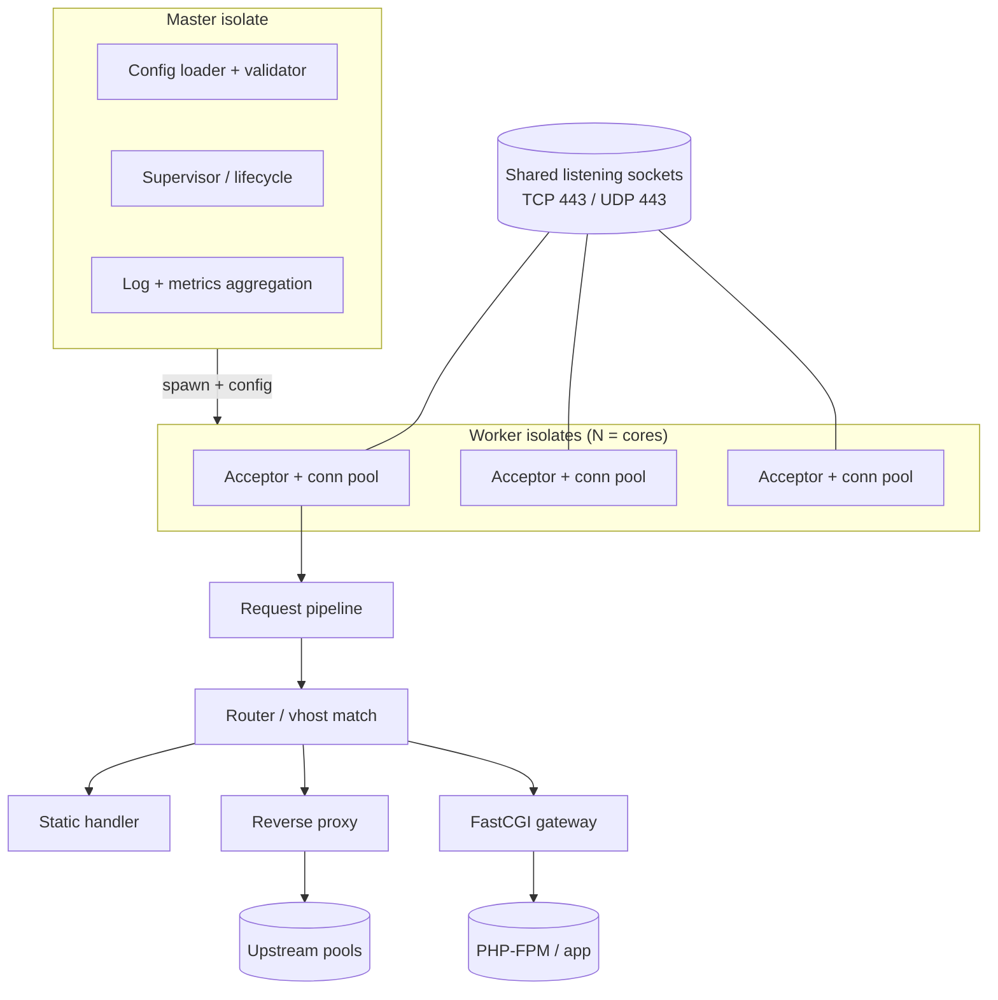
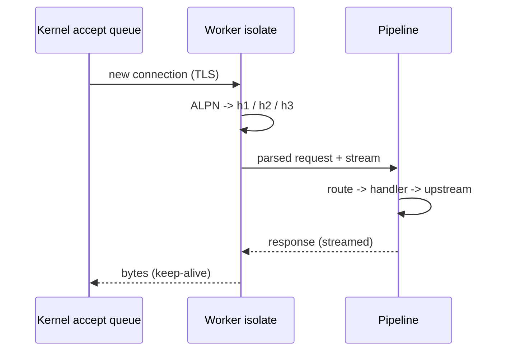

# 03 — Architecture

## High-level topology



## Concurrency model

- **Master isolate**: loads/validates config, binds shared sockets, spawns
  worker isolates, supervises them, and aggregates logs/metrics. Holds no
  per-request state.
- **Worker isolates**: one per CPU core. Each accepts connections from the
  shared listening socket(s) and runs the full request pipeline independently.
  Dart isolates share nothing by default, which maps cleanly to a
  shared-nothing worker model (like nginx workers).
- **Shared socket strategy**: bind with port sharing so every worker has its own
  accept queue (kernel load-balances). On Linux this is `SO_REUSEPORT`; in Dart,
  `ServerSocket.bind(..., shared: true)` and `RawDatagramSocket` per worker.



## Connection lifecycle

1. **Accept** raw socket (TCP) or QUIC connection (UDP).
2. **TLS handshake** (TLS 1.3); negotiate protocol via **ALPN**
   (`h3`, `h2`, `http/1.1`).
3. **Protocol dispatch** to the matching engine (h1 / h2 / h3).
4. **Request assembly**: method, target, headers, body stream.
5. **Routing**: server-name (SNI/Host) + location match → handler.
6. **Handler execution**: static, reverse proxy, or FastCGI.
7. **Response streaming**: back-pressure aware; chunked/length framed per proto.
8. **Keep-alive / stream reuse** or connection close; emit access log + metrics.

## Request pipeline (middleware chain)

A typed, ordered chain so features compose cleanly:

```
accept → tls → protocol → limits/ratelimit → routing → auth →
rewrite/redirect → cache-lookup → handler → cache-store →
compression → headers-policy → logging
```

Each stage is a small interface so middlewares are testable in isolation and
can short-circuit (e.g., rate limiter returns 429 before routing runs).

## Module layout (target)

```
lib/
  src/
    core/            # event loop glue, isolate supervisor, lifecycle
    net/             # sockets, TLS, ALPN, UDP/QUIC binding
    http1/           # HTTP/1.1 parser + writer
    http2/           # framing, HPACK, streams, flow control
    http3/           # QUIC binding (FFI), QPACK, HTTP/3 mapping
    pipeline/        # middleware chain + context
    routing/         # vhosts, locations, matchers
    handlers/
      static/        # files, ranges, conditional, compression
      proxy/         # reverse proxy + load balancing
      fastcgi/       # FastCGI client (PHP-FPM)
    cache/           # response + proxy cache
    config/          # model, parser, validation, hot reload
    observe/         # logging, metrics, tracing, health
    security/        # rate limit, request limits, header policy, WAF hooks
bin/
  dart_apache.dart   # CLI entry (serve, check-config, reload)
```

## State and memory

- **Shared-nothing per worker**; cross-worker coordination (e.g., shared cache
  stats, rate-limit counters) via the master isolate using `SendPort` messages
  or an optional external store (Redis) for cluster-wide limits.
- **Back-pressure** everywhere: body and proxy streams use bounded buffers so a
  slow client or upstream cannot exhaust memory.
- **Buffer pooling** for hot paths to minimize GC pressure under load.

## Why isolates (not threads)

Dart has no shared-memory threads for app code; isolates are the unit of
parallelism. A worker-per-core, shared-nothing design is the idiomatic and
highest-throughput model and mirrors nginx's worker processes.
