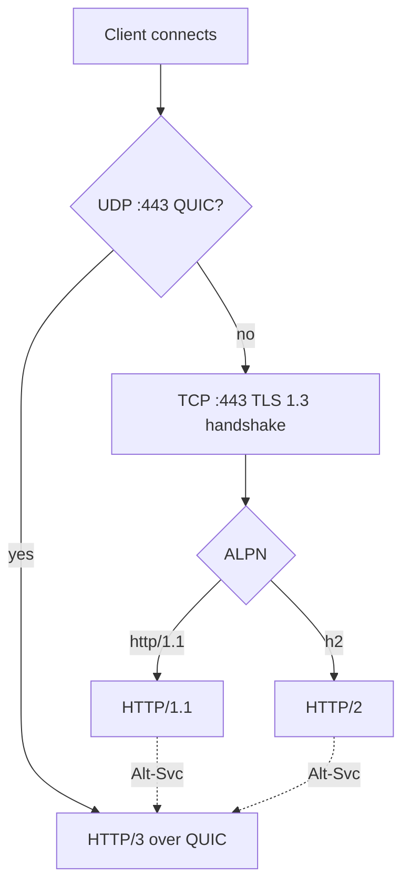

# 04 — Protocols and Transport

Goal: terminate HTTP/1.1, HTTP/2, and HTTP/3 with TLS 1.3 and ALPN-based
negotiation, degrading gracefully for older clients.

## Negotiation overview



- Advertise HTTP/3 via the `Alt-Svc` header so clients upgrade from h1/h2 to h3
  on subsequent requests.
- Keep a TCP listener (h1/h2) and a UDP listener (h3) on the same port (443).

## TLS

- **TLS 1.3 required** for h2/h3; TLS 1.2 allowed only for legacy h1.
- **SNI** for virtual-host certificate selection.
- **ALPN** to select `h3` / `h2` / `http/1.1`.
- **OCSP stapling**, session resumption (0-RTT carefully gated for h3).
- **Certificate management**: hot reload on cert change; pluggable ACME
  (Let's Encrypt) client for automatic issuance/renewal (later phase).
- Dart: `SecurityContext` + `SecureServerSocket` provide TLS and ALNP for
  TCP. For QUIC, TLS 1.3 is embedded in the QUIC library.

## HTTP/1.1

- Reuse `dart:io` HTTP parsing initially for speed of delivery, then replace
  with an owned parser (`http1/`) for keep-alive tuning, pipelining control,
  and tighter limits.
- Features: keep-alive, chunked transfer, `Expect: 100-continue`, absolute-URI
  targets (proxy), request/response trailers.

## HTTP/2

Owned implementation (or a vetted Dart h2 package wrapped behind our interface):

- **Framing** layer (HEADERS, DATA, SETTINGS, WINDOW_UPDATE, RST_STREAM,
  PING, GOAWAY, PRIORITY).
- **HPACK** header compression (static + dynamic table, size limits).
- **Stream multiplexing** with per-stream and connection **flow control**.
- **Concurrency limits** (`SETTINGS_MAX_CONCURRENT_STREAMS`).
- Defense against known abuse (Rapid Reset / CVE-2023-44487): cap stream
  churn and RST floods.
- Validate with **h2spec**.

## HTTP/3 and QUIC

QUIC is a UDP-based transport (TLS 1.3 built in, streams, 0-RTT, connection
migration). It is **not** available in `dart:io`, so this is the largest build
item.

### Transport options (decision in Phase 4)

| Option | Approach | Pros | Cons |
| --- | --- | --- | --- |
| **`dart_quiche`** (recommended) | Pure-Dart port of Cloudflare's quiche: QUIC v1/v2, TLS 1.3, loss recovery, congestion control (Reno/CUBIC/BBRv2), HTTP/3 + QPACK, WebTransport — all in Dart on `pointycastle` | **No FFI, no BoringSSL, no native build/packaging**; single-language stack; RFC 9000/9001/9002/9114/9204 coverage; qlog tooling | Early stage (`0.1.0-dev.x`); no PKI chain-to-root validation yet; unverified publisher — needs vetting/hardening for production |
| **FFI to a C QUIC lib** | Bind Cloudflare **quiche**, **ngtcp2+nghttp3**, or **msquic** via `dart:ffi` | Battle-tested C cores | FFI complexity, per-platform native builds, buffer marshaling cost |
| **Sidecar** | Run a QUIC terminator process, proxy to our h1/h2 core | Fast bootstrap | Extra hop/process; not a true single-server story |

**Plan:** adopt **[`dart_quiche`](https://pub.dev/packages/dart_quiche)** — a
pure-Dart QUIC + HTTP/3 stack (no FFI, no native dependencies) — behind a clean
internal `Http3Transport` interface. It already provides QUIC v1/v2, TLS 1.3,
loss recovery and congestion control, HTTP/3 framing, QPACK, and WebTransport,
with a minimal HTTP/3 server example (`bin/h3_server.dart`) and 486 unit tests.

It is **vendored** at `third_party/dart_quiche` and wired as a `path` dependency
in [../pubspec.yaml](../pubspec.yaml), so we can patch/harden it in-tree (e.g.
PKI validation) without waiting on upstream releases.

**Caveats to close before production** (track as Phase 4 work):
- Package is pre-1.0 (`0.1.0-dev.3`) and from an unverified publisher — pin the
  version, vendor/fork if needed, and add our own conformance gating.
- No chain-to-root PKI validation yet (leaf SAN + `CertificateVerify` are
  checked). For a *server* terminator this is less critical than for a client,
  but validate our usage and contribute/extend as required.
- Keep the `Http3Transport` seam strict so we can swap to an FFI core or a
  hardened fork without touching handlers if maturity becomes a blocker.

### HTTP/3 specifics

- **QPACK** header compression (QUIC analogue of HPACK).
- Stream mapping: each request/response on its own QUIC stream (no head-of-line
  blocking across requests).
- **0-RTT** early data: allowed only for idempotent, replay-safe requests.
- **Connection migration** support (client IP/port changes).
- UDP tuning: large receive buffers, GSO/GRO where available, pacing.
- Validate with **quic-interop-runner** and HTTP/3 clients (curl --http3).

## Protocol abstraction

A single internal interface normalizes all three protocols so handlers are
protocol-agnostic:

```
abstract interface class ServerTransport {
  Stream<ServerRequest> get requests;      // request + body stream
  // ServerResponse supports streamed writes with back-pressure.
}
```

`http1`, `http2`, and `http3` each implement this, exposing uniform
`ServerRequest` / `ServerResponse` objects to the pipeline.
