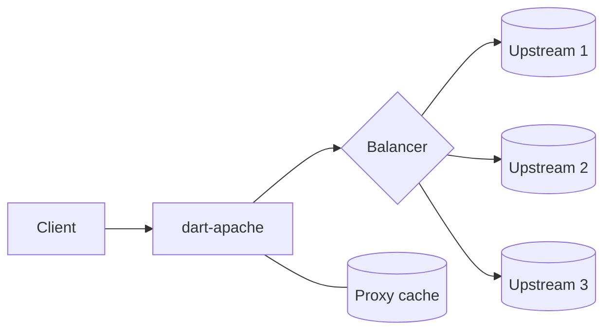
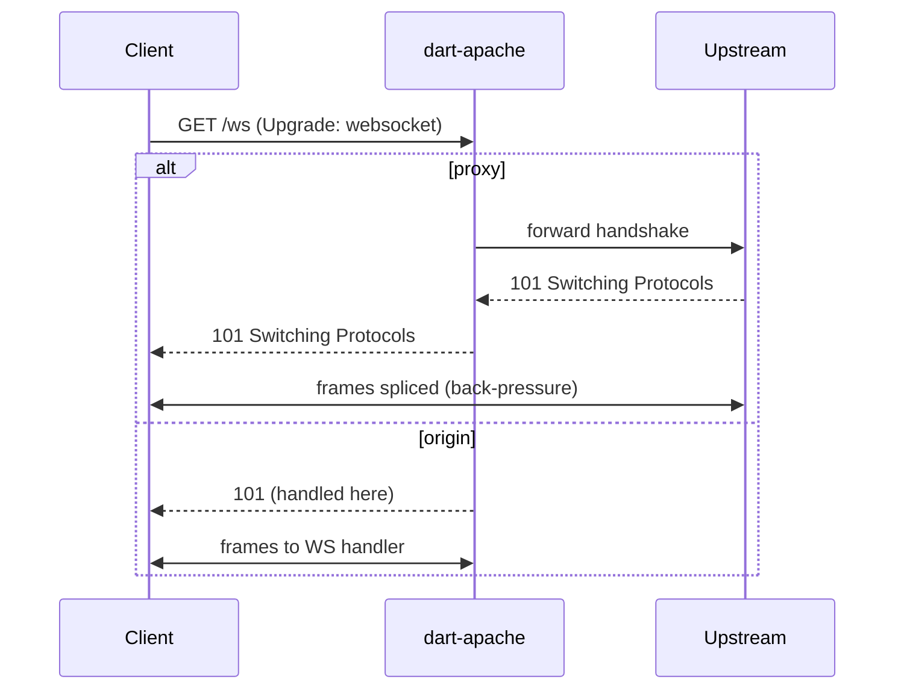

# 05 — Features

## Static file serving

- **Zero-copy** delivery via `sendfile`/`TransmitFile` through FFI where the OS
  supports it; fall back to streamed `openRead` otherwise.
- **Byte-range requests** (`Range`/`Content-Range`, multipart ranges) for media
  and resumable downloads.
- **Conditional requests**: `ETag` (strong, content/mtime+size based),
  `Last-Modified`, `If-None-Match`, `If-Modified-Since` → `304`.
- **Compression**: on-the-fly `gzip`/`br` with `Accept-Encoding` negotiation,
  plus precompressed `.gz`/`.br` sidecar files when present (nginx
  `gzip_static` style). Skip already-compressed types.
- **Caching**: open-file descriptor cache + metadata cache; optional in-memory
  small-file cache.
- **Index + autoindex**: `DirectoryIndex` equivalent, optional directory
  listing.
- **MIME**: full type map with charset defaults and override rules.
- **Security**: path normalization, traversal prevention, symlink policy,
  dotfile denial.

## Reverse proxy

- **Upstream protocols**: HTTP/1.1 to backends; keep-alive
  connection pools per upstream.
- **Header handling**: `X-Forwarded-For`, `X-Forwarded-Proto`, `Forwarded`,
  `Host` override, hop-by-hop header stripping.
- **Streaming**: full-duplex streaming with back-pressure; no full buffering of
  large bodies.
- **Timeouts & retries**: connect/read/write timeouts; safe retries on
  idempotent methods and connection errors; circuit breaking.
- **WebSocket & upgrades**: transparent `Upgrade` passthrough (details in
  [Real-time protocols](#real-time-protocols-websocket--webtransport)).

## Real-time protocols (WebSocket & WebTransport)

Two distinct jobs, each in two modes (origin = terminate here; proxy = pass
through to a backend):

### WebSocket (HTTP/1.1)

- **Origin (serve):** detect `Connection: Upgrade` + `Upgrade: websocket`,
  complete the RFC 6455 handshake (`Sec-WebSocket-Accept`), and hand matched
  locations to a WebSocket handler.
- **Proxy:** forward the `101 Switching Protocols` handshake to the upstream,
  then splice the two raw sockets **bidirectionally with back-pressure** until
  either side closes. Honors idle/handshake timeouts and connection limits.
- **Routing:** per-location opt-in; subprotocol (`Sec-WebSocket-Protocol`) and
  origin checks; message/frame size limits; optional permessage-deflate.

### WebTransport (HTTP/3 only)

- Requires the QUIC/HTTP/3 datapath; the vendored **`dart_quiche`** already
  implements WebTransport over HTTP/3 (Extended `CONNECT` with
  `:protocol=webtransport`, capsule framing, unidirectional `0x54` and
  bidirectional `WEBTRANSPORT_STREAM 0x41`).
- **Origin:** route Extended CONNECT to a WebTransport session handler exposing
  datagrams plus uni/bidi streams.
- **Proxy:** forward the CONNECT session and relay streams/datagrams to a
  backend (a later, niche capability).
- Depends on Phase 4 (HTTP/3); cannot exist before QUIC lands.

## Load balancing

- **Strategies**: round-robin, weighted round-robin, least-connections,
  IP-hash, consistent hashing (for cache affinity).
- **Health checks**: active (periodic probes) and passive (eject on errors),
  with slow-start re-introduction.
- **Session affinity**: cookie or hash based, optional.

## FastCGI (PHP, upgraded from CGI)

The prototype uses one-shot `php-cgi` per request. Enterprise PHP uses
**PHP-FPM over FastCGI** with persistent worker processes.

- Implement a **FastCGI client** (`handlers/fastcgi/`): multiplexed records
  (`BEGIN_REQUEST`, `PARAMS`, `STDIN`, `STDOUT`, `STDERR`, `END_REQUEST`) over
  a pooled TCP/Unix-socket connection to PHP-FPM.
- Map requests to FastCGI params exactly like the current CGI env mapping
  (`SCRIPT_FILENAME`, `QUERY_STRING`, `HTTP_*`, etc.) — the
  [php_handler.dart](../lib/src/php_handler.dart) CGI env logic ports directly.
- Benefits: persistent workers (no per-request process spawn), opcode cache
  reuse, dramatically higher PHP throughput.
- Keep the one-shot CGI handler as a fallback/compat mode.

## Additional gateways

- **SCGI** and **uWSGI** protocols for Python/other app servers.
- **Generic HTTP upstream** covers Node, Go, etc.

## Caching layer

- **Response cache** keyed by method+URI+Vary, honoring `Cache-Control`,
  `Expires`, `ETag`.
- **Proxy cache** for upstream responses with stale-while-revalidate and
  stale-if-error.
- **Storage**: in-memory tier + optional disk tier; LRU/TTL eviction.
- **Purge API** for invalidation.

## Content transforms

- Response compression (above), optional decompression for cache normalization,
  and range handling that cooperates with compression (compress-then-range
  rules).

## Routing & virtual hosts

- **Server blocks** matched by SNI/Host + port.
- **Location matching**: exact, prefix, and regex, with priority ordering.
- **Rewrites & redirects**: internal rewrites, external 3xx, canonical host/SSL
  redirects.
- **Try-files** style fallback chains (file → file → named handler).
