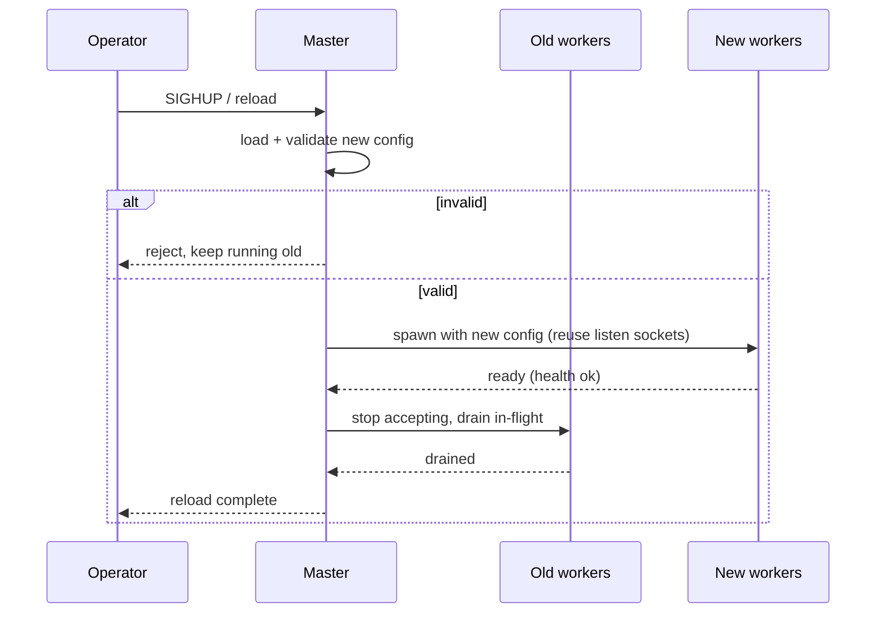

# 06 — Configuration

## Goals

- **Declarative** and **typed**: a config model with validation, not ad-hoc
  flags.
- **Validated before apply**: `check-config` fails fast with clear errors and
  line/location context.
- **Hot reload**: apply changes with **zero dropped connections**.
- **Composable**: includes/imports, environment interpolation, and per-vhost
  overrides.

## Format

Primary format: **YAML** (readable, typed via a schema). A future importer can
translate a subset of nginx `.conf` syntax.

### Example (illustrative target)

```yaml
server:
  workers: auto            # one isolate per core
  listen:
    - { address: "0.0.0.0", port: 443, tls: true, protocols: [h3, http/1.1] }
    - { address: "0.0.0.0", port: 80, redirect_to_https: true }

tls:
  certificates:
    - { host: "example.com", cert: "/etc/ssl/example.crt", key: "/etc/ssl/example.key" }
  min_version: "1.2"
  ocsp_stapling: true

limits:
  max_header_bytes: 32768
  max_body_bytes: 10485760
  request_timeout: 30s

sites:
  - host: "example.com"
    root: "/var/www/example"
    index: [index.php, index.html]
    locations:
      - match: { prefix: "/" }
        try_files: ["$uri", "$uri/", "@php"]
        static:
          compression: [br, gzip]
          cache_control: "public, max-age=3600"
      - name: "@php"
        fastcgi:
          pass: "unix:/run/php/php8.3-fpm.sock"
          index: index.php
      - match: { prefix: "/api/" }
        proxy:
          upstream: "api_pool"
          read_timeout: 60s

upstreams:
  - name: "api_pool"
    strategy: least_conn
    health_check: { path: "/health", interval: 5s, unhealthy_after: 3 }
    servers:
      - { url: "http://10.0.0.11:8080", weight: 2 }
      - { url: "http://10.0.0.12:8080" }

observability:
  access_log: { path: "/var/log/dart-apache/access.log", format: json }
  metrics: { prometheus: { listen: "127.0.0.1:9113" } }
  tracing: { otlp_endpoint: "http://localhost:4317", sample_ratio: 0.1 }
```

## Config pipeline

```mermaid
flowchart LR
  F[Config file + includes] --> P[Parse]
  P --> S[Schema validate]
  S --> R[Resolve env + defaults]
  R --> B[Build immutable Config]
  B --> V[Semantic checks\n(certs exist, upstreams resolve)]
  V --> A[Apply]
```

- **Immutable config object** built once and shared (copied) to workers.
- **Semantic validation**: certificate files readable, ports bindable, upstream
  hostnames resolvable, referenced names (`@php`, `api_pool`) defined.

## Hot reload (zero downtime)



- New workers come up on the **same shared sockets** before old ones drain.
- In-flight requests finish within a drain deadline; then old workers exit.
- A bad config never replaces a good running one.

## CLI surface

```
dart_apache serve   --config /etc/dart-apache/config.yaml
dart_apache check   --config /etc/dart-apache/config.yaml   # validate only
dart_apache reload                                          # signal running master
dart_apache version
```

The existing flag-based config ([config.dart](../lib/src/config.dart)) becomes a
thin adapter that produces the same immutable Config for simple/dev use.
