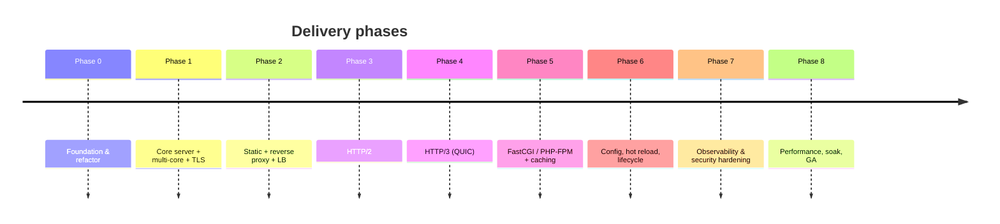

# 10 — Roadmap

Phased delivery. Each phase ends with a **usable, tested** server and explicit
exit criteria. Phases are sequenced to de-risk the hardest items (HTTP/3)
behind a solid, observable core.

## Phase 0 — Foundation & refactor
**Goal:** reshape the prototype into the target module layout without behavior
loss.
- Introduce `core/`, `net/`, `pipeline/`, `routing/`, `handlers/` structure.
- Define the `ServerTransport` / `ServerRequest` / `ServerResponse` interfaces.
- Port existing static + CGI handlers behind the new pipeline.
- **Exit:** current features pass through the new pipeline; all existing tests
  green.

## Phase 1 — Core server, multi-core, TLS
**Goal:** production-shaped HTTP/1.1 core.
- Isolate supervisor (master + worker-per-core) over shared sockets.
- TLS 1.3 termination, SNI, ALPN scaffolding.
- Owned/validated HTTP/1.1 engine with limits and timeouts.
- Graceful start/stop.
- **Exit:** multi-core HTTP/1.1 over TLS; limits enforced; h1 conformance tests
  pass.

## Phase 2 — Static serving + reverse proxy + load balancing
**Goal:** be a useful edge/proxy on h1.
- Zero-copy static, ranges, conditional requests, compression.
- Reverse proxy with keep-alive pools; round-robin + least-conn; health checks.
- **WebSocket**: origin upgrade handler (RFC 6455) and proxy passthrough
  (forward `101` + bidirectional socket splice with back-pressure).
- **Exit:** can front real backends; passes proxy correctness + static feature
  tests; WebSocket echo + proxy verified.

## Phase 3 — HTTP/2
**Goal:** modern multiplexed transport.
- Framing, HPACK, streams, flow control, concurrency limits.
- Rapid-Reset mitigation.
- **WebSocket over HTTP/2** via `CONNECT` + `:protocol=websocket` (RFC 8441).
- **Exit:** **h2spec** green; h2 reverse proxy and static verified under load.

## Phase 4 — HTTP/3 (QUIC)
**Goal:** the headline capability.

> **Status:** a working proof-of-concept exists
> ([`lib/src/http3/h3_php_server.dart`](../lib/src/http3/h3_php_server.dart),
> run via `bin/dart_apache_h3.dart`): it terminates QUIC + TLS 1.3, speaks
> HTTP/3, and serves static files + PHP (`php-cgi`) — verified with
> `dart_quiche`'s H3 client. Remaining work below hardens and integrates it.

- Adopt **[`dart_quiche`](https://pub.dev/packages/dart_quiche)** (pure-Dart
  QUIC + HTTP/3, no FFI) behind the `ServerTransport` / `Http3Transport`
  interface; build `http3/` on top of it.
- QUIC listener on UDP/443, QPACK, Alt-Svc advertisement, 0-RTT gating.
- **WebTransport** over HTTP/3 (Extended `CONNECT` with
  `:protocol=webtransport`), using `dart_quiche`'s WebTransport support; expose
  datagrams + uni/bidi streams to a session handler.
- Harden the dependency: pin/vendor the pre-1.0 package, add conformance gating,
  and validate TLS/cert handling for our server use.
- **Exit:** **quic-interop** targets pass; `curl --http3` and browsers serve over
  h3; graceful fallback to h2/h1.

## Phase 5 — FastCGI / PHP-FPM + caching
**Goal:** enterprise PHP + response/proxy cache.
- FastCGI client with pooled PHP-FPM connections (replaces per-request
  `php-cgi`); reuse existing CGI param mapping.
- Response cache + reverse-proxy cache with revalidation and purge.
- **Exit:** PHP app served via PHP-FPM at target throughput; cache hit/miss
  correctness verified.

## Phase 6 — Configuration, hot reload, lifecycle
**Goal:** operability.
- Declarative YAML config, schema + semantic validation, `check-config`.
- Zero-downtime hot reload and rolling worker restart.
- **Exit:** reload under load drops zero connections; invalid config never
  replaces a good one.

## Phase 7 — Observability & security hardening
**Goal:** run it in production safely.
- Structured logs, Prometheus metrics, OTLP tracing, health/readiness.
- Rate limiting, access control, header policy, request-smuggling defenses,
  optional ACME.
- **Exit:** dashboards + alerts in place; security test suite passes.

## Phase 8 — Performance, soak, GA
**Goal:** meet [09-performance.md](09-performance.md) targets and ship.
- Benchmark harness in CI with regression gates; flame-graph driven tuning.
- 24h+ soak and chaos tests; fuzzing of all parsers.
- **Exit:** performance targets met; soak clean; docs + release process
  complete → **GA 1.0**.

## Dependencies & risks

| Risk | Impact | Mitigation |
| --- | --- | --- |
| QUIC via FFI complexity | Phase 4 slip | Use pure-Dart **`dart_quiche`** (no FFI); keep a clean `Http3Transport` seam; FFI/quiche or sidecar as fallback |
| `dart_quiche` pre-1.0 maturity | h3 production readiness | Pin/vendor the version, add conformance gating, validate TLS/cert handling, contribute fixes upstream |
| h2/h3 spec edge cases | Correctness | Conformance suites in CI from the start of each phase |
| GC/latency under load | Perf targets | Pooling, streaming, early event-loop-lag metric |
| Native build/packaging | Distribution | Per-platform CI, pinned toolchains, SBOM |
| Scope creep | Timeline | Strict per-phase exit criteria; non-goals in [01](01-vision-and-goals.md) |

## Cross-phase definition of done

For every phase: tests green (unit + relevant conformance), metrics/logs for new
subsystems, docs updated, no known data-loss/security regressions, and a tagged,
runnable build.
