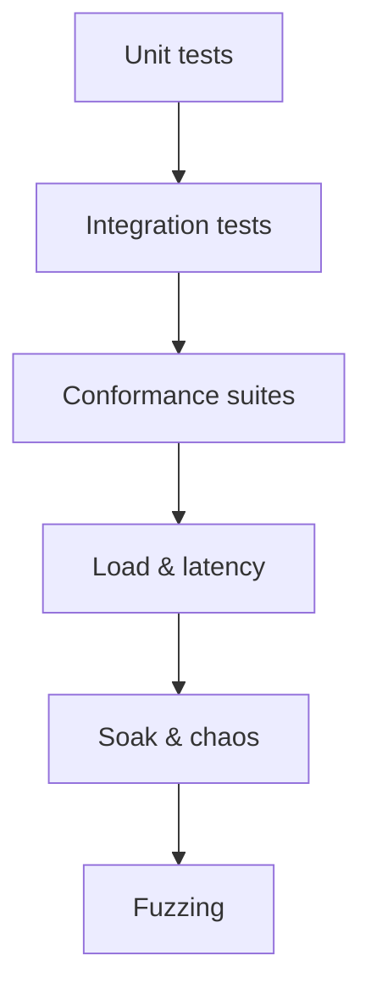

# 11 — Testing and Release

## Test pyramid



## Unit tests

- Pure logic: routing/match, config parsing/validation, header policy, range
  math, CGI/FastCGI param mapping, cache keying/eviction.
- Extend the existing suite in `test/` (already covers MIME and the request
  resolver).

## Integration tests

- Spin up the server on an ephemeral port and drive real requests (as done today
  for static/PHP/PATH_INFO).
- Cover: TLS handshake + ALPN selection, keep-alive, proxy passthrough,
  FastCGI to a test PHP-FPM, cache hit/miss/stale, reload-under-traffic.

## Protocol conformance (in CI)

- **HTTP/1.1**: targeted request-smuggling and framing tests.
- **HTTP/1.1**: targeted request-smuggling and framing tests.
- **HTTP/3/QUIC**: **quic-interop-runner** against reference clients/servers;
  `curl --http3` smoke tests.
- Run these per-phase as soon as the protocol lands and keep them green.

## Load & latency

- `wrk2`/`h2load`/`vegeta` constant-rate runs; record p50/p99/p999.
- Reverse-proxy latency overhead vs. direct-to-backend.
- Regression gate vs. stored baselines (see
  [09-performance.md](09-performance.md)).

## Soak & chaos

- 24h+ soak at sustained load; assert flat memory and stable latency.
- Chaos: kill/restart upstreams, drop packets (h3), slow clients (slowloris),
  config reload storms; assert no dropped connections or leaks.

## Fuzzing

- Fuzz all parsers: HTTP/1.1 request parser, HTTP/3
  QPACK, URI normalizer, FastCGI record parser.
- Corpus-driven, run continuously; crashes block release.

## Security testing

- TLS configuration scan (protocol/cipher posture).
- Request-smuggling and header-injection test vectors.
- Rate-limit and connection-limit behavior under abuse.
- Dependency/SBOM scanning for the native FFI libraries.

## CI/CD

```mermaid
flowchart LR
  PR[Pull request] --> B[Build + analyze]
  B --> UT[Unit + integration]
  UT --> CF[Conformance (quic-interop)]
  CF --> PERF[Perf smoke + regression gate]
  PERF --> SEC[Security + SBOM]
  SEC --> ART[Signed artifacts]
  ART --> REL{Release?}
  REL -- tag --> GA[Publish + changelog]
```

- `dart analyze` + `dart test` on every PR (matches current workflow).
- Multi-platform builds (Linux primary; Windows/macOS for dev) with pinned
  native toolchains for the QUIC FFI library.
- Reproducible builds; generate and publish an **SBOM**.

## Release process

- **Semantic versioning**; changelog maintained in
  [../CHANGELOG.md](../CHANGELOG.md).
- Phase completions map to minor releases; **GA 1.0** after Phase 8.
- Signed artifacts/container images; documented upgrade and rollback steps.
- Each release states the protocol/feature conformance level it has passed.

## Documentation deliverables

- Operator guide (install, config, reload, tuning).
- Config reference generated from the schema in
  [06-configuration.md](06-configuration.md).
- Migration notes (CGI → FastCGI; flags → declarative config).
- Reference dashboards and alert rules from
  [08-observability.md](08-observability.md).
